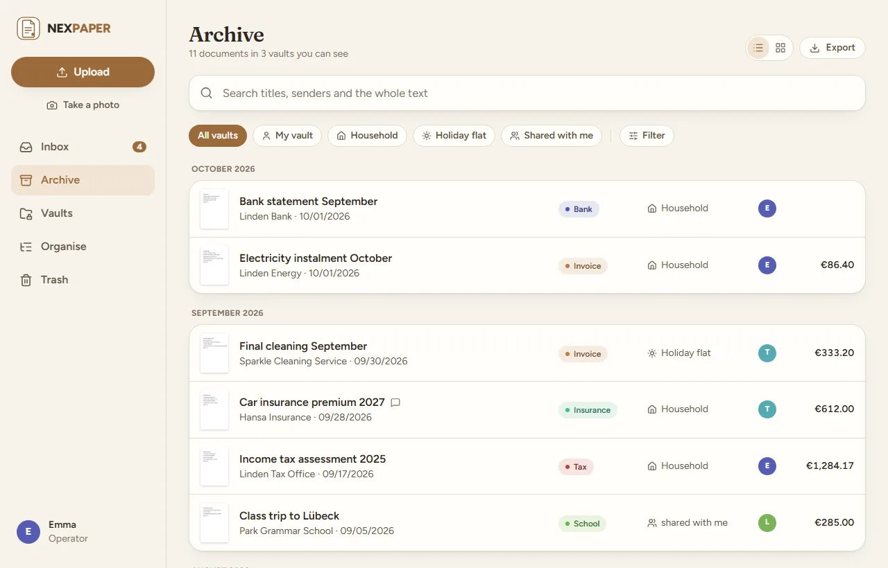
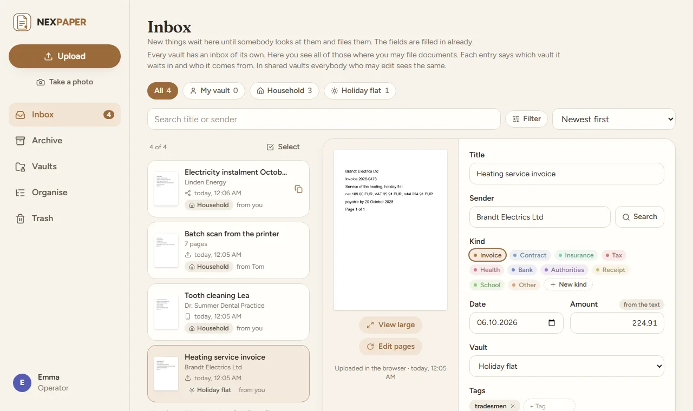
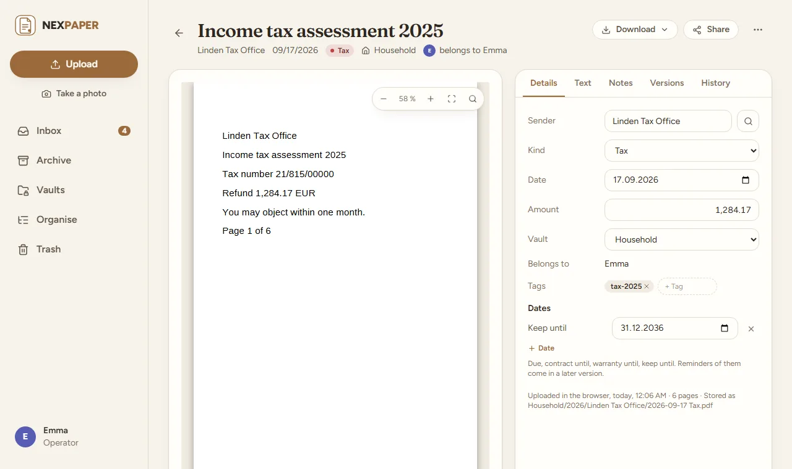
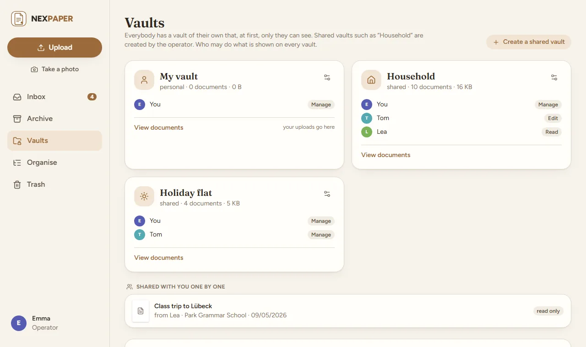
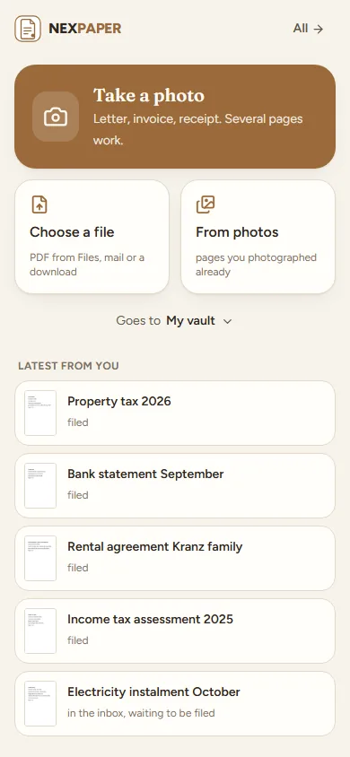

# nexpaper

**Paperless-ngx for the home: the simple version.** A light filing cabinet for the papers of a household or a small
firm, on your own server. Upload, find, done. One container, no Redis, no Celery, no Postgres, and an import that takes
over what you already have in Paperless-ngx.

- **One inbox for everything.** Photos from the phone, files from the browser, a scanner's folder, a mailbox, an import
  from Paperless: all of it waits in the inbox with the fields filled in, and one click files it.
- **Vaults.** Everybody has a vault of their own, and the operator makes shared ones ("Household", "Business"). Rights
  are read, edit or manage; single documents can also be shared with a person or, for somebody without an account, as a
  link that ends.
- **Text recognition and search.** Scans become searchable PDFs; the original stays exactly as it came, with its
  checksum. The search understands parts of words and filters (`kind:invoice amount:>100`).
- **Tools for pages.** Turn, delete and order pages, join documents, split a stack at blank separator sheets. Every
  change is a new version; nothing is overwritten.
- **For small firms.** E-invoices (ZUGFeRD, Factur-X, XRechnung) are read from their data, there is a history of who
  changed what, and an export for the tax adviser (a ZIP with the PDFs and a list). No claim of GoBD compliance.
- **No Redis, no Celery, no Postgres.** One container, SQLite, plain readable files on the disk.
- **Made to be on the internet:** a second factor from the start, passkeys, sign-in through your own provider, and a
  checklist in the settings. Everything the web app does goes through an open API for the apps that will come.

nexpaper is one of the nex apps and looks like them: light paper and kraft by day, a dark desk by night.

**1.0.0.** Back up `/data` like any other data of yours (the documents are plain files in `/data/dokumente`) and read
what a backup holds and what it does not (below). nexpaper is an independent project and not affiliated with
Paperless-ngx; it only reads from a Paperless-ngx server when you import.

<p align="center">
  <picture>
    <source media="(prefers-color-scheme: dark)" srcset="docs/screenshots/archive-dark.webp">
    
  </picture>
</p>

<table>
  <tr>
    <td width="50%"><picture><source media="(prefers-color-scheme: dark)" srcset="docs/screenshots/inbox-dark.webp"></picture></td>
    <td width="50%"><picture><source media="(prefers-color-scheme: dark)" srcset="docs/screenshots/document-dark.webp"></picture></td>
  </tr>
  <tr>
    <td width="50%"><picture><source media="(prefers-color-scheme: dark)" srcset="docs/screenshots/vaults-dark.webp"></picture></td>
    <td width="50%"><picture><source media="(prefers-color-scheme: dark)" srcset="docs/screenshots/phone-dark.webp"></picture></td>
  </tr>
</table>

The pictures show a made-up household.

## Start

```yaml
services:
  nexpaper:
    image: ghcr.io/derkezorm/nexpaper:latest
    container_name: nexpaper
    restart: unless-stopped
    ports:
      - "127.0.0.1:8560:8000"
    volumes:
      - ./data:/data
    environment:
      PUID: 1000
      PGID: 1000
      TZ: Europe/Berlin
```

```sh
docker compose up -d
```

Built from source instead: clone this repository, use `docker-compose.yml` as it is (it has `build: .`) and run
`docker compose up -d --build`. The file has every option explained.

Open `http://127.0.0.1:8560` on that machine (the port listens only there; the comment in
[docker-compose.yml](docker-compose.yml) says how to change that). The first account you create there is the operator.
It needs the **setup code** from the log, so that nobody who reaches a fresh instance first can take it:

```sh
docker logs nexpaper
```

shows the code, new at every start until nexpaper is set up. To choose it yourself, set `NEXPAPER_SETUP_TOKEN`. Right
after the password the account sets up its second factor; then the operator invites the others by link. Everything
personal is under "My account" for everybody; "Settings" is the operator's and holds the server.

## nexpaper on the internet

Many people will put nexpaper on the internet; it is made for that. Before you open it:

1. **Set it up first**, from your own network, with the setup code from the log. Only then forward a port.
2. **https at a reverse proxy**, and nexpaper reachable only through it: publish the port as `127.0.0.1:8560:8000` when
   the proxy runs on the same host, or keep both on a Docker network without a published port. Send HSTS from the proxy.
3. **Tell nexpaper about the proxy**: `NEXPAPER_PUBLIC_URL` (the address people use), `NEXPAPER_TRUSTED_PROXIES` (the
   proxy's address or network; without it every sign-in seems to come from the proxy and the brake against guessing
   cannot tell people apart) and `NEXPAPER_COOKIE_SECURE: "on"`.
4. **A second factor** is required from the start: right after the password every account sets one up (a code from an
   app, or a passkey) and keeps the recovery codes. The operator may switch the requirement off; do not.
5. **Look at "Ready for the internet?"** (Settings, Sign-in). It checks the points above for itself: https, the
   second factor, your own account with one, the brake, the server secrets, the cookies, the proxy and the backups.
6. **Backups somewhere else**, as carefully as the data folder. A backup holds every account and the server's secrets
   (`secret.key`) but **not the documents**: those are plain files in `/data/dokumente` and belong in the backup your
   server makes anyway. Try a restore with "Check" now and then.
7. **Leave the switches closed that you do not need**: API keys and the AI are off until the operator opens them. Pin a
   version instead of `latest`, update on purpose, back up before.
8. Nobody, the operator included, sets a password for somebody else. Whoever forgot theirs gets a link to set a new
   one: the operator sends it (Settings, Accounts), or, where a mail server and the public address are set, the
   person asks for it on the sign-in page. The link works once and for 24 hours.
9. Passkeys work under the public https address, or on localhost.

Optionally keep the operator's settings at home: `NEXPAPER_OPERATOR_NETWORKS: "192.168.0.0/16"` refuses them from
anywhere else (behind a proxy only together with `NEXPAPER_TRUSTED_PROXIES`).

## Where things are stored

Everything lives in `/data`:

| Where | What |
|---|---|
| `nexpaper.db` | The SQLite database: accounts, settings, the filing, the recognised text and the search index. |
| `secret.key` | The server's own secret (the OIDC secret, the mail password, the AI key and the like). |
| `backups/`, `logs/`, `locales/` | Backups, the log, extra languages as JSON files. |
| `dokumente/` | The documents themselves, as readable files: `<vault>/<year>/<sender>/<date> <title>.pdf`, the original as it came, beside it the searchable copy and the older versions. Readable without nexpaper. |
| `cache/`, `uploads/`, `exports/` | Pictures of pages (trimmed to a size you set), uploads in progress, ZIPs for the tax adviser. |
| `eingang/` | The intake folder, when it is switched on (Settings, Inputs): one subfolder per person. |

Mount `/data` from a local disk, never from an SMB or NFS share: SQLite's locking does not work reliably over network
filesystems. There is no per-person encryption: it would stop search and make the files unreadable without nexpaper. A
personal vault means only that nexpaper shows it to nobody else; protecting the disk is the operator's business.
When the operator deletes an account, they decide where the documents of its personal vault go, and may give them to
themselves or to a vault they are in: the dialog says so, and every document's history notes the takeover and by whom.

### Backup

A backup is one ZIP file with the **database, the settings and `secret.key`**, made while nexpaper runs (through SQLite's
backup function, never as a file copy). It holds **no documents**: they lie as plain files in `/data/dokumente` and belong
in the backup your server makes anyway (Hyper Backup, restic, snapshots). It holds **no search index** either: that is
the largest part of the database, and it is built anew from the recognised text after a restore (the search works while
that goes on, with more and more hits). Together with `secret.key` it opens the mail and AI credentials and the addresses
of open links, so keep backups protected.

Settings, Backups: automatic daily or weekly with a number to keep, "Back up now", upload, download, check and restore.
The **trial run** ("Check", and again in the dialog before a restore) starts the database of the archive the way the
server would, on a scratch copy, and says whether the archive is whole (a damaged one is told as damaged) and can be
started, which version made it (one from a newer nexpaper is refused), how many documents it knows, which of their files
are missing on the disk or have another checksum, which documents of today the restore would remove (their files stay in
the folder), and **which devices, keys and links it would bring back to life**: a backup does not know what you
withdrew after it was made. Download, delete and restore ask for the operator's password again. A restore keeps the state
before it as a backup; if it cannot be put in place at the restart, the staged files are put aside, you are told, and the
server goes on with the database it had. Moving to a new server: download a backup, upload it on the new one, check it,
restore it, and copy the documents folder along.

### Checking the files, and the storage card

Every file has a checksum. Once a week, and on a click (Settings, Backups, "Check files"), nexpaper reads them all in
small portions with pauses and compares. A document whose file is missing or changed gets a warning sign in the archive,
the inbox and on its page, a line in its history, and the operator a notice. The sign goes at the next check, or at once
when the operator asks for that one document on its page, when a new version of it was read, when a version that could
not be read is put away, or when the document comes back from the trash. The storage card beside it shows what the
database (and of it the search index), the documents, the cache, the exports and the backups take, and how much room is
left. It warns, here and in the log at the start, when the database lies on a network share.

## Updating

With an image: `docker compose pull && docker compose up -d`. Built from source: pull the new code and run
`docker compose up -d --build`. nexpaper adds what the database lacks at the start and makes a backup first; nothing
needs doing by hand. The way back is under Settings, Backups.

## Environment

| Variable | Default | Meaning |
|---|---|---|
| `NEXPAPER_DATA_DIR` | `/data` | Database, logs, backups, secrets and the languages |
| `NEXPAPER_LOCALES_DIR` | `<data>/locales` | Extra languages, one JSON file each |
| `NEXPAPER_SECRET_KEY` | made on first start | Protects server-side secrets; when set, it wins over `secret.key` |
| `NEXPAPER_PUBLIC_URL` | from the request | The address people use, for invitation links and the OIDC redirect. The setting in the interface wins |
| `NEXPAPER_TRUSTED_PROXIES` | none | Addresses or networks of reverse proxies whose `X-Forwarded-For` is believed, comma separated |
| `NEXPAPER_SETUP_TOKEN` | made at start | The code the first account needs |
| `NEXPAPER_OPERATOR_NETWORKS` | none | Networks the operator's settings may be changed from, comma separated |
| `NEXPAPER_SESSION_DAYS` | `30` | A session of "stay signed in on this device" ends after this many days without use |
| `NEXPAPER_COOKIE_SECURE` | `auto` | `on`, `off` or `auto` (from the request or `X-Forwarded-Proto`) |
| `NEXPAPER_COOKIE_SUFFIX` | none | Appended to the cookie names; keeps two instances on one host apart |
| `NEXPAPER_LOG_LEVEL` | stored setting | `quiet`, `normal`, `detailed` or `trace`; overrides the setting |
| `NEXPAPER_DECODE_SLOTS` | `1` | How many pictures are unpacked at the same moment (each takes some 150 MB while open) |
| `NEXPAPER_UPDATE_URL` | GitHub | Where the update check asks for the newest release |
| `NEXPAPER_ARGON2_TIME`, `NEXPAPER_ARGON2_MEMORY_KIB`, `NEXPAPER_ARGON2_PARALLELISM` | `3`, `65536`, `2` | Cost of the password hash; only the tests lower it |
| `NEXPAPER_FRONTEND_DIST` | `/app/static` | Where the built interface lies (set by the image) |
| `NEXPAPER_DISABLE_BACKGROUND` | `false` | Switches off the background jobs (backups, update check); for tests |
| `NEXPAPER_PORT` | `8000` | The port inside the container; only for host networking |
| `PUID`, `PGID` | `1000` | Owner of the files in the data directory |
| `TZ` | | The time zone of the container's log. People's own time zones come from their browsers |

## AI

The AI is off until the operator chooses a service, for everybody (Settings, AI): none, a **local model** in your own
network (Ollama or anything that speaks `/v1/chat/completions`), a service on the internet that speaks the same, or one
that speaks the Messages API. Every person can switch it off for their account. It proposes title, sender, kind, date and
amount for a new document where nothing surer (an e-invoice, a rule, the same sender as last time, the text itself)
knew them; a proposal is only a proposal, and the inbox says where each field came from.

- A local service must lie in your own network and a service on the internet must be reached over https: an address
  that points elsewhere is refused, when it is saved and at every request. The API key is sealed and never shown again.
- What goes out is the text of the first two pages and the list of kinds the document can have, nothing else. Documents
  in personal vaults stay away from it unless the operator lets them in.
- The operator sets a **limit of documents per day** for the whole server (200 from the start, 0 for none), so that a
  large delivery does not send every document, one request each, to a service that is paid for by the request. When it is
  reached, the documents keep what the rules and the text gave them until the next day.

## Filing

New documents wait in the inbox with proposals. **Rules** (a vault's own, made by its managers, and the operator's for
the whole server) fill in a vault, a kind, a tag, a sender or a title when conditions hold; their words are compared as
plain text, never as patterns. A rule of the operator's for the whole server does not reach into the personal vault of
anybody else. **Kinds** come in two sorts: the ones that come with nexpaper and the operator keeps, and the ones a vault
makes for itself (anybody who may edit it, with "+ New kind" at the end of the choice of kinds; a name that sounds like
an existing one is shown first). A document that moves takes its kind along by name. E-invoices (ZUGFeRD, Factur-X,
XRechnung) are read from their data, with limits on the size and the shape of the XML.

Everything that deletes or locks out asks first, and says whether it can be undone (a document in the trash stays 30
days and can be brought back; one deleted for good, a key, a link or a device that is locked out cannot).

## Push

The notice of a new sign-in arrives by Web Push, to every device a person signs up (My account, Devices and apps). It
needs https (or localhost). On an iPhone it works only for the app added to the home screen (Share, Add to Home Screen)
and only from iOS 16.4. The server makes its own keys; the operator can add a contact and further push services. A push
never carries the content of a document.

## On the phone

A phone opens on the **quick upload** (once per visit; a switch under My account, Upload): take a photo, choose a file,
see what was uploaded last and what waits in the inbox, and choose the vault files go to. **The camera** finds the edges
of the page by itself (OpenCV in the browser, served by nexpaper itself and loaded only on that page), takes the picture
once the page holds still, lets the corners be pulled by hand, offers colour, greyscale and black and white, and makes
one PDF of several pages. It needs https (or localhost), like every camera in a browser.

- **Android**: nexpaper added to the home screen stands in the share menu of every app. The shared files stay on the
  phone until the person taps "Upload".
- **iPhone**: Safari puts no web app into the share menu, so a shortcut steps in. iOS imports only shortcuts signed by
  Apple, so nexpaper cannot ship the file: My account explains how to build it in four steps with a key that only
  uploads, and the operator can share a finished one by an iCloud link
  ([docs/iphone-shortcut.md](docs/iphone-shortcut.md)).
- **Pairing a device**: a QR code under My account, valid for five minutes and once, or OAuth 2 with PKCE for apps. Each
  device gets a token of its own and stands with the signed-in devices, where it can be signed out.

## Inputs

Besides the browser and the phone, documents come in two more ways (Settings, Inputs). Nothing from either is filed by
itself: it all waits in an inbox.

- **Intake folder**: a folder in the container (`/data/eingang` unless you name another one, mounted as a volume for a
  scanner or a share) with a subfolder per person. A file is taken once it lay still for 10 seconds, goes into that
  person's inbox and leaves the folder; what is not taken (another kind of file, too large, empty) is moved to
  `abgelehnt/` beside it with the reason. Files in the folder itself or in a subfolder nobody has go to the operator,
  marked unknown. Links are not followed, hidden and temporary files are left alone.
- **Mailbox**: one IMAP mailbox for the whole server, fetched every 5 minutes. PDF, pictures and e-invoices as XML are
  taken from the mails, also from forwarded ones; the mails themselves do not become documents. A mail belongs to the
  person whose confirmed address it comes from (My account, Upload) or who is named in `paper+<account>@`; everything
  else goes to the operator, marked unknown (or stays in the mailbox, if you choose so). Once every part was taken the
  mail is marked read, moved to `nexpaper` or deleted; a mail with parts over the limits stays and is flagged. The first
  start takes only the unread mails. TLS or STARTTLS is required (without it only for a server on the same machine), a
  server in your own network must be allowed first, and switched off nothing connects. A stranger who knows the address
  can send files into an inbox: nexpaper limits how much per run and day, see [SECURITY.md](SECURITY.md).

## From Paperless, and for the tax adviser

- **Import from Paperless-ngx** (Settings, Import; the operator): give the address and an API token, look first (how
  many documents, tags, correspondents and types, who owns what), choose a person here for each owner and whether each
  document goes into the own vault of its person or everything into one vault. The documents come with the file as it
  came, the searchable copy and the text Paperless recognised (nothing is read again), title, date, sender, kind, tags,
  notes, custom fields (as a note) and the people they were shared with. It runs in the background, can be stopped and
  goes on where it stopped, also after a restart; running it again takes only what is new. Office files (Word, Excel)
  are not taken; when Paperless made a PDF of one, that PDF becomes the document and its history says so. What is
  skipped is in the log with its reason. Paperless itself is only read.
- **Export** (Archive, Export): a ZIP of the documents of a period and of chosen vaults, with the filters of the
  archive: the searchable PDFs, the originals if wanted, e-invoices as XML and a list as CSV (Excel opens it as it is),
  in folders as on the disk. It is made and fetched in the browser, packed in the background, and a notice says when it
  is ready. Instead of downloading
  it, the ZIP can go to the tax adviser as a link without an account, valid as long as links are (Settings, Sharing);
  it shows when it was opened and can be revoked.

## For programs

Everything the web app does goes through `/api/v1`; the web app uses nothing else. A phone or a later app pairs with a
**device token** (My account, Devices and apps) and acts with the rights of its account; scripts use an **API key**
that only reads or only uploads (off until the operator switches it on; 120 requests a minute, 50 uploads an hour). The description is served at `/api/v1/docs` and, for
machines, at `/api/v1/openapi.json`; [docs/api.md](docs/api.md) says how to sign in.

## Security in short

- Passwords are hashed with Argon2id. Five failed sign-ins lock an account and an address for 15 minutes; with a second
  factor, the password alone opens nothing. A session ends after 30 days without use, or after 12 hours when "stay signed
  in" was not ticked, and every device can be signed out on its own.
- Rights are checked on the server for every request. A wrong device token or API key counts against the sender like a
  wrong password. A device token never changes the way into the account (password, second factor, passkeys), never
  reaches the operator's side (settings, accounts, backups, the log) and never pairs another device; a lost phone is blocked in the list and stops at once.
- Every changing request of a browser needs a header a page on another site cannot send. Cookies are `HttpOnly` and
  `SameSite`; the Content Security Policy only allows the app's own files. Only the worker that finds the edges of a page
  in a photo may compile code at run time (OpenCV); it sees pixels and nothing else.
- Addresses the server reaches out to (the AI, push services, the mailbox) are checked against the internet and the home network:
  resolved once, connected to exactly as checked, no redirect followed, never a metadata address.
- A backup is read with limits (nothing but its three parts, a manifest of at most 64 KB, the bytes counted while
  unpacking) and tried out on a scratch copy before a restore, and downloading, deleting, uploading and restoring one ask
  for the operator's password again. A restore brings back devices, keys and links withdrawn after the backup; the trial
  run counts them.
- The log never contains the content of a document, passwords, keys or tokens.

How to report a problem: [SECURITY.md](SECURITY.md).

## Development

```sh
cd backend && python -m venv .venv && .venv/Scripts/python -m pip install -r requirements-dev.txt
.venv/Scripts/python -m pytest -q
.venv/Scripts/python -m uvicorn app.main:app --port 8560 --no-proxy-headers --no-server-header
cd frontend && npm ci && npm run dev && npm test && npm run lint && npm run build
```

On Linux the virtual environment's programs are in `.venv/bin`. The frontend on port 5571 sends `/api` to the backend.
The tests need no network and keep their data in a folder of their own. When the interface changes on purpose, renew the
recorded description: `NEXPAPER_RECORD_OPENAPI=1 python -m pytest tests/test_routes.py`.

## License

[AGPL-3.0](LICENSE).

The icons are [Lucide](https://lucide.dev) (ISC, partly MIT from Feather); the fonts are Fraunces and Figtree (OFL-1.1).
Their notices ship with the app at `/licenses/`. Everything else nexpaper ships or depends on, with its licence, is
listed in [THIRD-PARTY.md](THIRD-PARTY.md).
